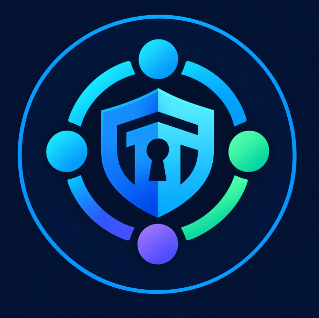

<div align="center">




</div>

---

### 🖥️ `boot sequence`

```console
[  OK  ] Started Team Collaboration Daemon
[  OK  ] Mounted /home/team/projects
[  OK  ] Reached target Secure Development
[  OK  ] Reached target Open Source Goodness

Welcome to Arkoprabho Roy's GitHub Profile for Team Projects and Collaboration
Last login: Sat Oct 24 from github.com
```

---

### 👥 `whoami`

```console
guest@team-hq:~$ whoami
guest

guest@team-hq:~$ hostname
team-hq

guest@team-hq:~$ ls /home
guest  Arkoprabho-Roy

guest@team-hq:~$ finger Arkoprabho-Roy
```

```text
Login: Arkoprabho-Roy              Name: Arkoprabho Roy
Directory: /home/Arkoprabho-Roy    Shell: /bin/bash
Role: Account Owner & Project Collaborator
Plan:
  Security-first student developer. I catch the bugs so you don't have to.
```

```console
guest@team-hq:~$ cat /home/Arkoprabho-Roy/bio.txt
```

```text
Hi, I'm Arkoprabho Roy, a second year BTECH CSE(AIML) student at
Institute of Engineering and Management, Salt Lake.

I'm a student who's passionate about cybersecurity, and I bring a
security-first approach to every team I join: I review code with an
eye for bugs and vulnerabilities, and aim to catch them early before
they ship.

I take responsibility and ownership for my team and our projects,
so I contribute wherever I can by taking on whatever work helps
the team most and lightens my teammates' load.

My primary roles within the team projects include: Backend
Developer, Security and Vulnerability Tester, and
Cybersecurity Lead. 

I also step up to lead projects when the team needs it, most recently
MediLink.
```

---

### 📂 `ls -la ~/projects`

```console
guest@team-hq:~$ ls -la ~/projects
```

```text
total 32
drwxr-xr-x 4 Arkoprabho-Roy Arkoprabho-Roy        4096 Oct 24 10:42 .
drwxr-xr-x 5 Arkoprabho-Roy Arkoprabho-Roy        4096 Oct 24 09:15 ..
drwxrwxr-x 4 Arkoprabho-Roy Arkoprabho-Roy        4096 Oct 24 13:27 Arkoprabho-Roy
drwxrwxr-x 8 Arkoprabho-Roy soham-newjourney2     4096 Oct 19 14:10 HelpSphere
```

| Project | Description | Status | Stack | 
|---|---|---|---|
| [`HelpSphere`](https://github.com/Arkoprabho-Roy/HelpSphere) | `HelpSphere connects surplus food and essentials with people who need them, through verified NGOs. Donors give, NGOs collect and verify, and people in need follow every step of their request.`<br> `🏆 3rd place at Innovare, Innovacion'26, IEM Kolkata. `<br> ` | ✅ Complete | `HTML` `CSS` `JS` `PHP` `MySQL/MariaDB` |
---

### 🧰 `cat ~/.toolchain`

```console
guest@team-hq:~$ cat ~/.toolchain
```

```yaml
# the stack we build with
languages:  [Python, JavaScript, Java, Bash, PHP]
backend:    [FastAPI, PHP, PostgreSQL, MySQL/MariaDB]
security:   [Nmap, Burp Suite, Wireshark, ]
```

<div align="center">


</div>

---

### 🔐 `sudo ./make-me-admin.sh`

```console
guest@team-hq:~$ sudo ./make-me-admin.sh
[sudo] password for guest:
guest is not in the sudoers file. This incident will be reported.
```

```text
Nice try. 😄 Want write access? Earn it the usual way:
open a pull request and ask a teammate to review it.
```

---

### 🤝 `./contribute.sh`

```console
guest@team-hq:~$ cat contribute.sh
```

```bash
#!/bin/bash
# How to collaborate with us

git clone https://github.com/Arkoprabho-Roy/<repo>.git
cd <repo>
git checkout -b feature/your-feature

# ...hack responsibly...

git commit -m "feat: describe your change"
git push origin feature/your-feature
# Then open a Pull Request and tag a reviewer
```

> **House rules:** no direct pushes to `main` · every PR needs a review · never commit secrets · test before you merge.

<div align="center">

```console
guest@team-hq:~$ exit
logout

[Process completed] — Thanks for visiting. Fork it. Break it. Fix it. Ship it.
```
</div>
